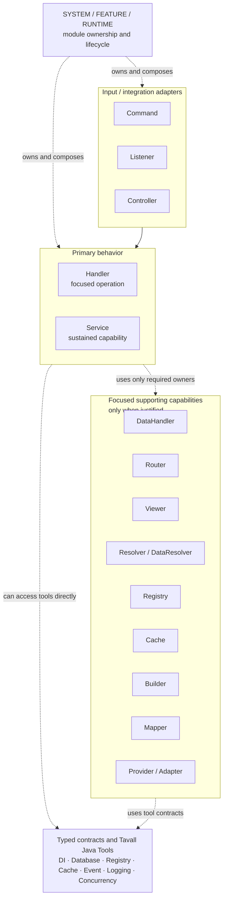

# Tavall Class Roles

> **Status:** Active  
> **Authority:** Binding chapter of [Tavall Studios Code Architecture](../CODE_ARCHITECTURE.md)  
> **Applies to:** Tavall production modules, contributors, automation, generated code, reviews, and AI-assisted development

Classes should have one coherent reason to change. Role suffixes are architectural contracts, not decorative nouns added after implementation.

## Core Roles

| Role | Responsibility |
| --- | --- |
| `*Data` / `*State` | Typed values/state. Not service lookup or mutable storage infrastructure. |
| `*Request` | Operation input. |
| `*Result` | Typed operation outcomes. |
| `*Handler` | One focused behavior/operation family. |
| `*DataHandler` | Domain data access/update policy when application behavior genuinely needs that boundary. |
| `*MetaDataHandler` | Derivation/normalization/enrichment of metadata. |
| `*Service` | One cohesive reusable domain capability. |
| `*Orchestrator` | Ordered workflow/lifecycle coordination across focused collaborators. |
| `*Router` | Select and delegate. |
| `*Resolver` | Resolve an existing typed value or capability from supplied input and a designated authority. | 
| `*DataResolver` | Resolve domain data from supplied keys/context; not display titles or rendering. |
| `*Viewer` | Derive a caller-facing view/title/presentation from already available typed values; does not fetch data or render to a device. |
| `*Registry` | Runtime keyed identity/lookup ownership. |
| `*Cache` | Disposable/expiring/reloadable fast-state ownership. |
| `*Builder` | Construct typed values/definitions/requests/results/configuration. |
| `*Mapper` | Convert representations. |
| `*Reader` / `*Writer` | Read/write a real source or capability when that is the actual role. |
| `*Bootstrap` | Startup/composition ownership. |
| `*Runtime` | Active-generation/system lifecycle ownership. |
| `*Type` / `CustomEnum` | Extensible enum-like family values. See [ENUMS.md](ENUMS.md). |

##### Why

Naming a real role makes ownership visible before reading implementation. The suffix should answer what kind of behavior or lifecycle the class owns, not merely provide a respectable-sounding noun.

## Class Role Ownership Graph (Conceptual)

This is a **responsibility diagram, not a mandatory class hierarchy or call pipeline**. `SYSTEM`, `FEATURE`, and `RUNTIME` are module/lifecycle classifications. Input adapters delegate; focused Handlers own ordinary operations; Services are rare sustained capabilities. Supporting roles are selected only when needed. Consumers may use Tavall Java Tools directly through their approved typed contracts; no intermediary Service or Resolver is required.



Registry/Cache appear both as specialized domain owners and as Java Tools: the concrete domain capability and its underlying canonical implementation have distinct responsibilities. A `Viewer` or `DataResolver` need not exist just because an output is shown or data is accessed. A meaningful behavioral interface is preferred for shared capabilities, while bare `@DelegatesTo` can register a concrete-only DI component. Utility interface composition is the default where applicable. Orchestration is a responsibility; existing `*Orchestrator` implementations remain under role review.

See [Interfaces and Abstractions](INTERFACES_AND_ABSTRACTIONS.md), [Utilities](UTILITIES.md), and [Registry/Cache Tool Authority](REGISTRIES_CACHES_AND_REPOSITORIES.md).

## Enums and CustomEnum Values

Closed sets of domain states, priorities, and fixed values use native Java `enum`. Dynamically extensible sets intended for cross-module or plugin contribution must extend `CustomEnum<T>` (`tavall-custom-enum-java`). See the canonical chapter: [Tavall Enums & Extensible Enum Values](ENUMS.md).

## Handler, Service, and Orchestrator

A **Handler** owns one focused behavior or operation family. A **Service** owns one reusable cohesive capability used across consumers. An **Orchestrator** owns ordering/lifecycle across several focused boundaries.

### Service creation gate

**Do not introduce a `*Service` as a generic layer or the default name for new behavior.** Before creating one, identify its concrete reusable capability, actual consumers, domain policy it alone owns, state/lifecycle owner, and why existing Handlers, Resolvers, DataHandlers, Orchestrators, Runtimes, and canonical Tavall Java Tools cannot own the same work. Reject a Service that merely forwards existing methods, renames a Registry/Cache lookup, implements a second cache/registry, or collects unrelated operations. Existing valid `*Service` implementations are not automatically renamed or removed; check their real behavior and callers.

Where a Registry or Cache owns identity or cached state, use the **actual** `tavall-registry` or `tavall-cache` API with its approved access patterns. Refer to [Registry and Cache Tool Authority](REGISTRIES_CACHES_AND_REPOSITORIES.md#canonical-tool-authority) rather than duplicating the tool's API in a Service or this chapter.

Input adapters such as commands/listeners/controllers receive external input and delegate. They do not become the reusable domain owner merely because input arrived there first.

##### Why

These roles separate operation behavior, reusable capability, and multi-step sequencing. Without that distinction, one class slowly absorbs rules, storage, routing, and lifecycle until its suffix stops meaning anything.

## Resolver and Viewer

Use a `*DataResolver` for domain data resolution, a `*Viewer` for deriving a presentation from data already supplied, and a `*Formatter` for simple representation formatting. Do not name display-title derivation `*Resolver` merely because the method returns a derived value. The existing `AchievementPointTitleResolver` is a migration candidate for `AchievementPointTitleViewer`; its pure mapping has no lookup authority. `Viewer` is a **class role**, not a new module type or a mandatory extra layer. Maintain its actual consumer contract during any rename; do not manufacture a second Viewer beside the existing Resolver.

Pure, deterministic Viewers may legitimately be non-DI when they have no managed behavior and are expressly excluded by policy; `@ExplicitNonDi` on the current title mapper records that reason. Pluggable, DI-managed Viewers use `@DelegatesTo` and typed `DependencyAccess`, without simultaneously retaining `@ExplicitNonDi`.

## Builders

Builders construct typed output. They do not resolve Tavall-managed dependencies, wire runtime graphs, register managed behavior, persist, authorize, or schedule work.

##### Why

Construction should remain predictable from explicit inputs. Hidden runtime behavior turns a builder into an alternate service/composition system.

## Registry and Cache

Registry and Cache are infrastructure-backed ownership roles:

- Registry for runtime identity/definitions/providers/sessions/indexes;
- Cache for disposable/reloadable/expiring/stale-able fast state.

Ordinary consumers do not recreate these with mutable maps.

## Durable Persistence

Tavall application persistence is modeled through **Tavall Database entity classes and the entity persistence contract defined by the checked-in `tavall-database` version**.

Shared class-role docs do not prescribe a concrete Tavall Database accessor and do not create a parallel persistence class role around it.

## The `*Manager` Anti-Pattern

**A generic `*Manager` is not an approved Tavall application class role.** New Tavall-owned application classes and interfaces must not use `*Manager` / `I*Manager` as a catch-all behavior suffix. Classify the **actual responsibility** before naming the type. Do not merely substitute `*Service` or `*Handler` while leaving a god class intact.

| Actual owned responsibility | Prefer |
| --- | --- |
| One action or cohesive operation family | `*Handler` |
| Domain data access/update policy | `*DataHandler` |
| Runtime keyed identity, active sessions or definitions | `*Registry`, using Tavall Registry |
| Disposable, expiring, or reloadable fast state | `*Cache`, using Tavall Cache |
| Multi-target input dispatch with real destination choice | `*Router` |
| Domain value or target resolution | `*Resolver` / `*DataResolver` |
| Presentation from supplied values | `*Viewer` / `*Formatter` |
| Construction of typed output | `*Builder` |
| Ongoing cohesive shared capability with independently justified lifecycle | `*Service` |
| Active module/runtime-generation ownership | `*Runtime` / `*Bootstrap` |
| Platform/protocol boundary | `*Adapter` / `*Gateway` |
| Focused infrastructure operation with no better existing owner | Precise `*Handler` or a **canonical tool-owned** name, justified from source |

A class holding a map is not necessarily a Registry: first establish **who owns the state** and read the actual `tavall-registry` API. A class with several methods is not automatically a Service. A class forwarding to existing Handlers may need to disappear entirely rather than be renamed to a Router. Avoid unnecessary new interfaces: [Interfaces and Abstractions](INTERFACES_AND_ABSTRACTIONS.md) allows bare `@DelegatesTo` for genuinely concrete-only managed behavior.

### Scope and exceptions

- This is a **new Tavall-owned application declaration** rule. Do not rename third-party or JDK API types such as `EntityManager`, `PluginManager`, or an externally fixed contract. Do not reinterpret product/UI titles such as **Discord Manager** as Java role policy.
- Existing Tavall `*Manager` declarations are **migration candidates**, not instructions to break working APIs, generated DI tokens or externally consumed names immediately. A narrowly established canonical Tavall Java Tool that deliberately publishes a `*Manager` type can retain its approved public API; document the ownership and use its actual contract instead of creating a local imitation.
- Do not evade this rule with `ManagerImpl`, `ManagerService`, `CoreManager`, `GeneralHandler`, `CoordinatorManager`, a `manager` package, or an `I*Manager` interface. The **behavior**, not just the file name, must become focused.

### Existing production evidence and migration selection

The following concrete classes are **current code evidence, not approved targets for blind renaming**:

- [`AccountLinkAdminManager`](https://github.com/TavallStudios/tavall-mc/blob/main/novus-backend/src/main/java/org/tavall/api/minecraft/backend/account/AccountLinkAdminManager.java) already implements `IAccountLinkAdminHandler` but forwards to several specialized admin Handlers. Check whether that forwarding class is needed at all, or whether the aggregation is a genuine operation boundary.
- [`AccountLinkManager`](https://github.com/TavallStudios/tavall-mc/blob/main/novus-backend/src/main/java/org/tavall/api/minecraft/backend/account/AccountLinkManager.java) implements `IPlayerAccountLinkHandler` but mixes token inspection, completion/fallback, account mutation, and auditing. Audit and separate responsibilities as needed before renaming the existing owner.
- [`AccountLinkSessionManager`](https://github.com/TavallStudios/tavall-mc/blob/main/novus-backend/src/main/java/org/tavall/api/minecraft/backend/account/AccountLinkSessionManager.java) implements `IAccountLinkSessionHandler` and creates link sessions. Candidate: `AccountLinkSessionHandler` after consumer/DI and session lifecycle audit.
- [`CreatorAccountManager`](https://github.com/TavallStudios/tavall-mc/blob/main/novus-backend/src/main/java/org/tavall/api/minecraft/backend/account/CreatorAccountManager.java) implements `ICreatorAccountLinkHandler`. Candidate: `CreatorAccountLinkHandler`, with a separate check that the `creatorStatus` read path does not unintentionally create accounts.
- [`GitWorktreeManager`](https://github.com/TavallStudios/tavall-ai/blob/main/tavall-ai-core/src/main/java/org/tavall/ai/app/orchestration/GitWorktreeManager.java) prepares Git worktrees and gathers status/diffs. Reassess its Git workspace operation boundary and Spring/runtime ownership before choosing a precise Handler or other established tool-owned role.

### Migration acceptance

1. Inventory usages, public APIs, declared interface contracts, runtime ownership, DI registration and callers (including tests/reflection, commands, config, and any external names). Audit analogous `*Manager` occurrences in affected production/active PR sources, not just `main`.
2. Classify every method by operation, state authority, persistence access, routing, scheduling, lifecycle and effects. Identify a canonical owner before creating a replacement.
3. Reuse existing focused classes, Tavall Java Tools and interface contracts; **audit broadly, change deliberately**. Do not add forwarding compatibility Services or duplicate Registries/Caches. Keep legacy aliases temporarily only if proven necessary, explicitly bounded, and tested.
4. Migrate behavior, classes, interfaces, DI bindings, consumers, package imports and tests together. Preserve actual semantics, result contracts, account security, audit events, and module hot reload/startup.
5. Validate exact-source module compilation, relevant integration tests, cleanup/replacement and negative paths before merging. Report untested runtime/provider acceptance separately.

##### Why

`Manager` conceals whether the class executes domain behavior, owns state, routes input or manages a lifecycle. That ambiguity allowed collection-of-everything classes and forwarding layers to grow; substituting a fashionable suffix without moving responsibilities merely repaints the same design flaw.

## Prohibited `*Repository` Class Name

**New Tavall-owned production declared types ending in `Repository` are prohibited.** This applies to classes, interfaces, records, enums, and other production type declarations.

Rejected:

```text
PlayerRepository
IPlayerRepository
PostgresPlayerRepository
MessageRepository
```

Existing `*Repository` types are migration debt only and must be deleted/renamed as their behavior moves to the correct owner. They are not templates or substitution boundaries for new work.

Do not evade the ban with `RepositoryImpl`, `RepositoryAdapter`, `RepositoryStore`, or an equivalent wrapper whose purpose is preserving repository architecture.

##### Why

The Repository role repeatedly preserved obsolete persistence layers after Tavall Database had already taken ownership. A hard naming prohibition prevents generators and engineers from recreating the same wrapper under the comforting banner of abstraction.

## Static Classes

Static classes/methods are for constants, pure transformations, parsing, formatting, and construction-only factories. Runtime behavior requiring DI, state, I/O, replacement, scheduling, persistence, or platform access remains instance-owned.

## Inner and Nested Classes

Inner/nested classes are exceptional in Tavall production code. Prefer a top-level declared type when the type has independent behavior, lifecycle, state, injection, I/O, persistence, registration, platform access, or meaningful reuse outside its enclosing type.

A narrow acceptable pattern is a `static` nested namespace used to express a compile-time hierarchy of closely related constants. The canonical example is [`Routes.java`](../WEB_ARCHITECTURE.md#routesjava):

```java
public final class Routes {

    private Routes() {}

    public static final class Dashboard {
        public static final String ROOT = "/dashboard";

        private Dashboard() {}

        public static final class Merchant {
            public static final String ROOT = Dashboard.ROOT + "/merchant";
            public static final String SHIPMENTS = ROOT + "/shipments";

            private Merchant() {}
        }
    }
}
```

This exception requires all of the following:

- the nested type is `static`;
- it acts as a namespace rather than a runtime collaborator;
- it has no mutable state;
- it has no enclosing-instance dependency;
- it owns no DI, I/O, persistence, scheduling, registration, or platform behavior;
- nesting makes the compile-time hierarchy materially clearer than a flat constant list or a collection of trivial one-purpose files.

Do not use this exception to hide Services, Handlers, Registries, Builders, data models, or other real production roles inside another class.

##### Why

Most inner classes obscure ownership and couple a real type to an unrelated enclosing implementation. Static namespace classes are different: they model lexical hierarchy without creating runtime coupling. For route constants, `Routes.Dashboard.Merchant.SHIPMENTS` communicates ownership directly while remaining a compile-time constant usable by Spring annotations. Splitting every namespace into a separate file would add filesystem ceremony without creating a meaningful architectural boundary.

## Persistence-Adjacent Capability Names

If behavior near persistence is real application behavior, name what it actually does: `HistoryReader`, `AuditWriter`, `SynchronizationHandler`, `SnapshotService`, `ImportHandler`, `ExportWriter`, or another precise capability. Do not default back to Repository.

## Review

Reject a class when:

- its role/name does not match its ownership;
- it mixes unrelated domains/lifecycle phases;
- it owns mutable keyed state that belongs to Registry/Cache/Tavall Database/operation runtime;
- it constructor-injects Tavall-managed dependencies;
- it ends in `Repository` and is not already grandfathered migration debt;
- it introduces a Tavall-owned application `*Manager` / `I*Manager` role, or merely renames legacy Manager behavior without separating actual ownership;
- it exists mainly as a forwarding wrapper with no independent behavior or lifecycle;
- it uses an inner/nested type for a real runtime role that should have explicit top-level ownership;
- a nested namespace type violates the narrow static, stateless, compile-time-only exception above.
